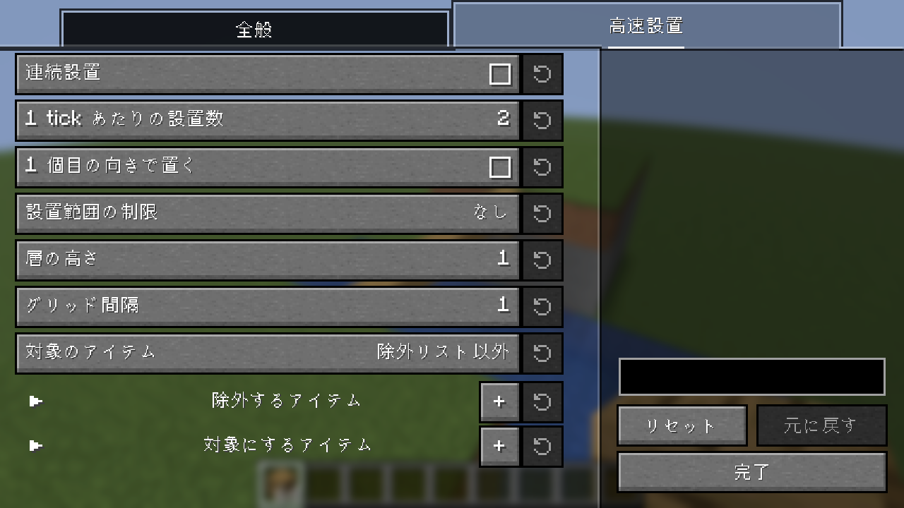

# Placement Plus

[English](README.md) | 日本語

ブロックの設置を楽にする Fabric 向けクライアント MOD です。
クライアントに入れるだけで動作し、バニラサーバーでも使えます（サーバー側への導入は不要です）。

## 機能

- **高速設置**：ブロックを持って右クリックを押している間、4 tick ごとではなく、照準の動きに合わせてブロックを置きます。照準が別のブロックに移るたびに 1 個置くので、なぞるだけで床や壁を埋められます。ブリッジの設置先にも効きます。
  「高速設置」タブでは、照準を止めていても置き続ける**連続設置**、2 個目以降を 1 個目と同じ向きでそろえる**1 個目の向きで置く**、置ける範囲の制限（平面・同じ面・縦一列・十字・層・斜め、グリッド間隔）、高速設置を使うアイテムを設定できます。
- **足場設置**（初期状態は OFF）：手に持っているのと同じブロックをクリックすると、足場ブロックのように、その並びを延長した先に置きます。
- **設置先プレビュー**：横に設置・足場設置・ブリッジで、狙ったブロックの手前以外に置かれるとき、ブロックの枠を実際に置かれる場所に移して表示します。

  

- **柔軟設置**：ブロックの面を中央と 4 つの端に分けます。「回転」キーを押しながら置くと、狙った端の方向を向いているものとして置きます（中央は通常と逆向き）。「横に設置」キーを押しながら置くと、狙ったブロックの、その端の側の隣に置きます。

  

  

- **スニークなしで設置**：チェスト、作業台、ドアなど使えるブロックにも、スニークせずにブロックを置けます。

  

- **ブリッジ**：ブロックを持って何もない所を見ているとき、視線上でブロックに接している空間を設置先にし、設置先プレビューが ON ならその空間を枠で表示します。足場の端までスニークで寄らなくても、立っているブロックの側面に置けます。

  

## 設定

各機能の ON/OFF は設定画面で切り替えられます。設定画面は [Mod Menu](https://modrinth.com/mod/modmenu) から開きます。
キーは初期状態では割り当てられていません。操作設定の「Placement Plus」で割り当ててください。
高速設置・ブリッジ・足場設置には ON/OFF を切り替えるキーが、設置範囲の制限には順に切り替えるキーがあります。

## 注意

サーバーによっては、ルールでこれらの機能が禁止されていたり、アンチチートに検出されたりすることがあります。
使用はサーバーのルールに従ってください。
