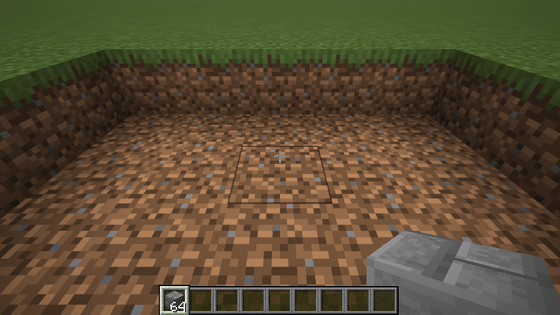
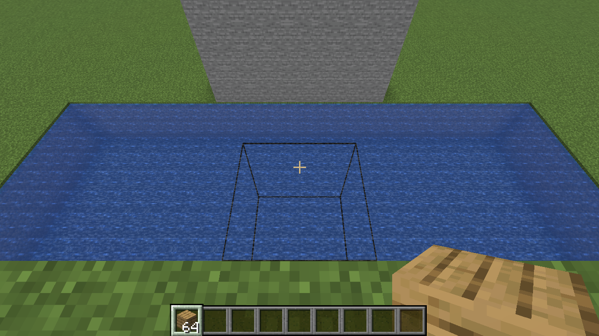
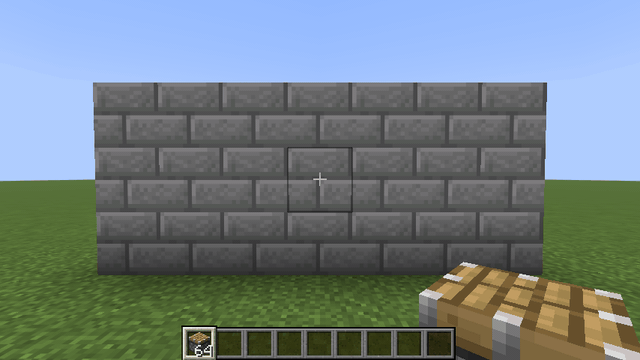
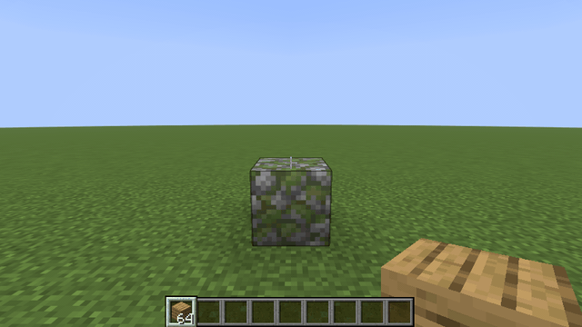
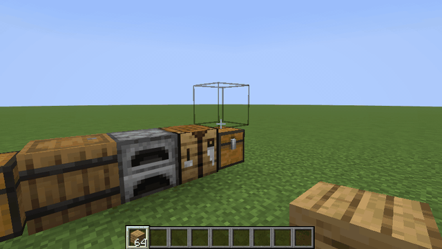
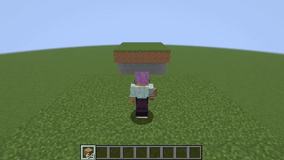
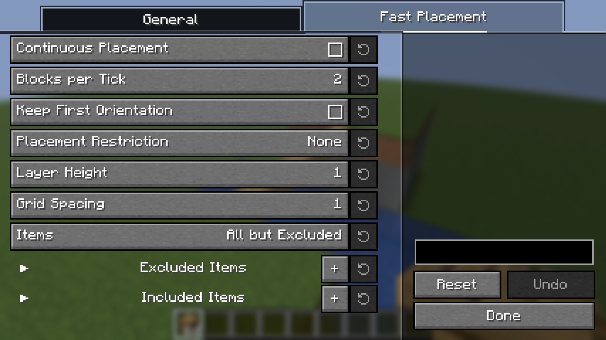

# Placement Plus

English | [日本語](README.ja.md)

A client-side Fabric mod that makes placing blocks easier.
Just install it on your client; it also works on vanilla servers (nothing needs to be installed on the server).

## Features

- **Fast Placement**: while you hold right-click with a block, blocks are placed as the crosshair moves instead of every 4 ticks, including at Bridging targets: one block each time the crosshair moves onto another block, so sweeping fills floors and walls.
  On the Fast Placement tab you can turn on **Continuous Placement** (keeps placing even with the crosshair still) and **Keep First Orientation** (later blocks face like the first), restrict where blocks after the first may go (plane, same side, column, cross, layer, diagonal, and a grid spacing), and choose which items it is used with.
- **Scaffold Placement** (off by default): clicking the same block as the one in your hand extends the run of that block, like scaffolding.
- **Placement Preview**: when Place Beside, Scaffold Placement or Bridging would put the block somewhere other than in front of the block you aim at, the block outline moves to where it will actually go.

  

- **Flexible Placement**: each block face is split into a center and four edges. Hold **Rotate** to place the block as if you were looking toward the edge you aim at (the center reverses the usual direction), or **Place Beside** to put it next to the block you aim at, on that edge's side.

  

  

- **Place Without Sneaking**: place blocks against chests, crafting tables, doors and other usable blocks without sneaking.

  

- **Bridging**: when the crosshair points at nothing while you hold a block, the empty space along your line of sight that touches a block becomes the target and is outlined (with Placement Preview on). You can place against the side of the block you stand on without sneaking to its edge.

  

## Settings

Each feature can be turned on and off in the settings screen, opened from [Mod Menu](https://modrinth.com/mod/modmenu).
The keys are unbound by default; assign them under Controls → Placement Plus.
Fast Placement, Bridging and Scaffold Placement also have keys to turn them on and off, and there is a key to step through the placement restrictions.

## Note

Some servers prohibit these features in their rules, and some anti-cheat plugins may flag them.
Follow the rules of the server you play on.
